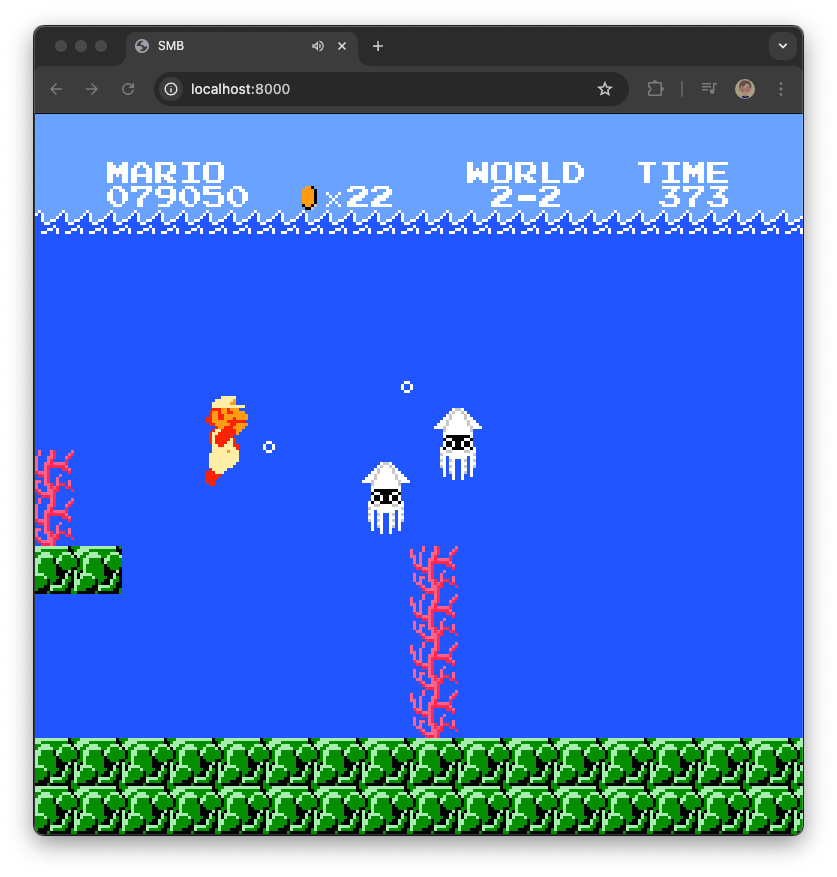

# SMB

[Play it online](https://nathsou.github.io/smb/)

Static recompilation of Super Mario Bros. from the ROM into C and
WebAssembly. The repository contains no game code or data: the recompiler
reads your own copy of the ROM, and `maps/smb.map` gives its routines, tables
and variables this project's own names. The page recompiles the ROM in the
browser and shows the generated C next to the game.

[](https://nathsou.github.io/smb)

## Controls

- D-Pad: WASD
- B: K
- A: L
- start: Enter
- select: Space
- z: Save state
- x: Load state

## Checkpoints

- [x] Static translation of the disassembly to low-level C
- [x] PPU & APU emulation layers
- [x] Convert subroutines to C functions
- [x] Convert most gotos to if statements
- [x] Remove unused flag updates
- [x] Replace PPU with direct draw calls (display state written directly, GPU renderer)
- [x] Emit instructions as C instead of instruction-emulation helpers
- [x] Infer routine interfaces (registers and flags read and produced)
- [x] Recompile from the ROM with our own names (no disassembly in the repository)
- [x] An IR shared by a C and a WebAssembly backend, with optimisation passes
- [x] Recompile in the browser, with a code viewer
- [ ] Registers as C locals and parameters
- [ ] Manually rewrite portions of the code to higher level C

See [toward a modern C program](docs/modern-runtime.md) for how these steps are
done and checked.

## Building

### Linux & MacOS

1. Fetch the submodules:
```bash
$ git submodule update --init --recursive
```

2. Build raylib, follow the instructions [here](https://github.com/raylib-extras/raylib-quickstart)

3. Install MoonBit (see Codegen), place a legally obtained dump of SMB called
   `smb.nes` in the root folder, then recompile it and build:
```bash
$ make codegen
$ make build
```

4. Run `./smb` from the root folder (it loads `web/video.frag`, the GPU
   renderer's shader; `./smb --software` uses the software renderer;
   `--debug-chr` draws with generated placeholder tiles)

## WebAssembly

The page recompiles your ROM in the browser: the recompiler (MoonBit compiled
to JavaScript) turns it into a WebAssembly module and C, which a code viewer
shows next to the game (SHOW CODE; the map tab is editable and recompiles).

1. Install a recent `clang` with the `wasm32` target and MoonBit (see Codegen)
2. Run `make web`
3. Serve the `web/` folder over HTTP and open `index.html`
4. Load a legally obtained dump of SMB; it stays in your browser

DEBUG TILES draws with generated placeholder tiles instead of the ROM's, and
`?software` in the URL selects the software renderer instead of WebGL2.

## Codegen

1. Install [Moonbit](https://www.moonbitlang.com/):

```bash
$ curl -fsSL https://cli.moonbitlang.com/install/unix.sh | bash -s '0.10.9+6e6c44045'
```

2. Place your `smb.nes` in the root folder and run `make codegen`; the C goes
   to `codegen/game/` (not in the repository)

The game is recompiled from the ROM image and `maps/smb.map`, which gives the
routines, tables and variables this project's own names (see
[recompiling from the ROM](docs/modern-runtime.md#recompiling-from-the-rom)).
The generator recovers reachable instructions and callable regions from the
vectors, builds an IR, optimises it and emits structured C and, with
`--wasm`, WebAssembly. The hand-written display routines
(`codegen/native/display.c`) use `codegen/native/smb.h`, the map's names as
a C header (`make header`, no ROM needed). See the
[analysis and migration notes](docs/recompiler-migration.md) and
[toward a modern C program](docs/modern-runtime.md).

Run `python3 tests/check_codegen.py` for the ROM-free suite (as CI does):
generator tests, and the independent NROM fixtures (from assembly and from an
iNES image) through both backends, natively and in WebAssembly. With your
`smb.nes`, append `--rom` to also recompile the game, replay the recorded
7,987 frames natively against `tests/golden/warpless.trace` (debug and ROM
tiles), run the differential test of every generated routine
(`tests/check_routines.py`) and replay the WebAssembly build
(`tests/web/replay_split.mjs`). These checks do not require Raylib.

The GPU renderers can be compared with the software renderer pixel for pixel:
`make gpu-check && xvfb-run ./gpu_check --debug-chr` (desktop) and
`NODE_PATH=$(npm root -g) node tests/web/gpu_check.cjs` (WebGL2 in headless
Chromium, needs Playwright).

Calls are plain C calls. Return addresses are not kept on the emulated stack,
except by the inline-table dispatchers, which read their table through it.

To compile another compatible assembly input into a separate directory:

```bash
moon run src/main -- --input tests/nrom128.asm --output /tmp/nrom-codegen
```

## References & Resources

- [doppelganger's disassembly](https://www.romhacking.net/documents/344/), which this project was originally built from
- [SuperMarioBros-C by MitchellSternke](https://github.com/MitchellSternke/SuperMarioBros-C)
- [Nesdev Wiki](https://www.nesdev.org/wiki/Nesdev_Wiki)
- [nessy](https://github.com/nathsou/nessy)
- [An Overview of NES Rendering by Austin Morlan](https://austinmorlan.com/posts/nes_rendering_overview/)
